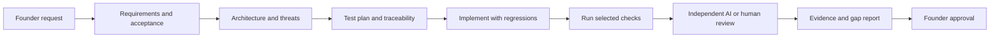

# ParentPlus Feature Delivery Workflow

This is the reusable execution procedure for Codex and other repository-capable assistants using their actual supported tools. Follow [Engineering Standards](ENGINEERING_STANDARDS.md), `AGENTS.md`, relevant Superpowers skills and the task's permissions. Codex should perform the available safe work through completion, without asking the founder to run routine terminal commands. No scheduler or autonomous feature-building service is installed by this document.



## 1. Establish the request and baseline

Inspect branch, full HEAD and all existing tracked/untracked changes. Use the authorized branch and existing cloud checkout; preserve prior work. Read the applicable agent entrypoint, [Project Context](PROJECT_CONTEXT.md), [Agent Handoff](AGENT_HANDOFF.md), `docs/superpowers.md` and the context map's task-relevant documents, including roadmap, decisions, build progress and quality evidence. State the intended outcome and material assumptions. Inspect connected repository/configuration evidence before asking for information already available.

Resolve routine implementation choices autonomously within scope. Ask only for decisions that change product/privacy semantics, missing authorization or genuinely unavailable prerequisites; continue independent work while waiting. Current session restrictions override older checkpoint/terminal guidance.

Output: product problem, target users, included/excluded behavior, acceptance examples, branch/baseline and scope note.

## 2. Analyze requirements, architecture and dependencies

Inspect affected callers/routes/components/libraries, database contracts, role checks, lifecycle transitions, migrations, dependencies and workflows. Separate current implementation from design/deployment claims. Write/update a dated spec and plan under `docs/superpowers/` using brainstorming/planning guidance without repeating questions already answered by the request.

For a new requirement, allocate a stable registry ID as planned and record scenarios, risk and decision/source references. For a changed requirement, update its description/acceptance criteria and identify affected callers/tests; split implemented and future slices instead of claiming the whole feature completed. A change that removes a guarantee or downgrades risk/status requires rationale and independent review. Preserve still-valid tests.

Output: affected-component map, architecture/dependency choices, privacy/security threat notes and any founder decision needed.

## 3. Prepare the test and impact plan

Map every acceptance criterion and threat to executable unit, integration, security, concurrency or E2E scenarios as applicable. Include unhappy paths, anonymous/other-workspace/suspended/revoked actors, malformed inputs, retries, rollback and both race orderings. Propose missing scenarios explicitly; AI suggestions are hypotheses until reviewed and implemented.

Collect current exact identities and run the deterministic selector:

```bash
python3 scripts/quality/quality_gate.py inventory
python3 scripts/quality/quality_gate.py self-test
python3 scripts/quality/quality_gate.py plan --output test-results/quality/feature-plan
```

Use a full plan for uncommitted work. Use `--base <verified-ref>` only for a committed comparison; unknown/empty/divergent history selects full regression. The new plan binds current nonignored source bytes. Local `--changed-file` examples are diagnostic overrides and must not be used to certify the complete feature scope.

Output: acceptance-to-test matrix, selected suites/reasons, missing scenario list and release-blocking checks. `planned` is not a test result.

## 4. Implement safely

Write a meaningful failing test/reproduction first where practical; inspect the failure, implement the smallest correction and verify behavior. Preserve authorization and data boundaries. Use synthetic local fixtures and network-isolated PostgreSQL only. Do not enable live OTP, access a hosted database, add paid services or weaken verification as a shortcut.

Link the exact new collected cases in the registry. Follow supported standalone entrypoints and update legacy runner module lists/count safeguards intentionally. Keep critical/high implemented requirements covered. Update feature docs and decisions when behavior changes; never silently rewrite a product/privacy decision.

Output: code, regression tests, current requirement mapping and documented deviations.

## 5. Execute and verify evidence

Install only missing prerequisites using pinned/locked commands and the managed proxy/CA. Inspect existing variable names/presence before requesting secure configuration. A missing service/tool is setup work to diagnose, not permission to skip its required checks. Keep setup fixes separate from product defects.

Run the suites selected by the plan and the feature-specific matrix. The gate is a minimum; E2E, migration, performance or privacy checks required by acceptance criteria remain required even if v1 has no runner for them. Preserve command exit status. Do not count skipped/disabled cases or zero-test runs as passing.

Generate execution receipts only after each entire suite and its required checks succeed:

```bash
# First generate the full plan, then run the frontend tests/lint/typecheck/build
# and/or the isolated database runner as documented in the gate guide.
python3 scripts/quality/quality_gate.py attest --suite frontend \
  --plan test-results/quality/feature-plan/quality-gate.json \
  --reports apps/web/test-results
python3 scripts/quality/quality_gate.py attest --suite database \
  --plan test-results/quality/feature-plan/quality-gate.json \
  --reports test-results/database
```

Verify the plan against current source, required job outcomes and all selected fresh reports/receipts using the guide's `verify` command. In CI, outcomes come from job dependencies and receipts include run/attempt identity; local declarations remain an explicit trust boundary. A receipt is a source/report linkage record, not proof against a malicious contributor rewriting the runner.

If source changes, regenerate the plan and rerun affected checks/receipts. If unrelated docs change after a full feature run, retain that run as historical. Rerun the selected checks for the new full snapshot, or after a separately verified checkpoint derive a genuinely documentation-only Git comparison and execute its quality checks. Never regenerate product receipts for older full-plan reports. Do not relabel an old report as a new execution. Missing/incomplete evidence blocks the claim it was intended to support.

## 6. Obtain an independent review and resolve findings

Provide the fresh reviewer with spec/plan, full scope including untracked files, baseline, tests, evidence and known risks. Request correctness and adversarial review. Do not provide repository write permission as part of the review. Use a supported reviewer tool/model when available; if unavailable, disclose it and leave independent review pending for a human.

For each confirmed defect, retain the precise reproduction, add a failing regression, fix the cause and rerun relevant checks. Record the outcome of the reproduction, not only that unrelated tests stayed green. Reassess evidence after every fix. Record disputed findings and accepted limitations explicitly; unresolved security or acceptance failures block delivery.

Output: severity-ranked findings, disposition and regression evidence. AI review does not authorize any checkpoint or release.

## 7. Present evidence and ask for the specific approval

Update build progress and the feature report with current capabilities, incomplete work, exact files and remaining risks. Present:

- Branch, full HEAD, source fingerprint, dirty/uncommitted scope and intended checkpoint contents.
- Acceptance/requirement mapping, tests and commands with actual outcomes.
- Independent findings/fixes, skipped/unrun checks, release blockers and founder decisions.
- Exact requested next action: for example, approval to commit the reviewed local scope.

Stop before committing unless approved after this presentation. An approved commit is then verified and recorded; push, hosted CI inspection, merge, repository settings, hosted migration and deployment remain separately authorized actions. Never claim hosted CI succeeded until a matching real run has been inspected.

## Shared-document maintenance and concurrent writers

The [context map](PROJECT_CONTEXT.md) identifies the single owner of each topic.
Update verified progress after a meaningful slice, architecture/decisions when
those boundaries change, [Quality Evidence](QUALITY_EVIDENCE.md) after checks, and
[Agent Handoff](AGENT_HANDOFF.md) at the end of a meaningful session. Record why an
owner document did not need a change instead of creating a parallel copy.

Start with observed branch/HEAD, dirty scope, context availability and intended
file ownership. Check expected file contents before patching; if another writer
changed them, stop and reconcile rather than reset or overwrite. Use coordinated
single-writer ownership for overlapping files and review the full final diff.
These instructions and hash checks are not an atomic lock against unrelated
writers. A locking/compare-and-write helper for automated maintenance needs a
separate implementation and review; none is installed here.

Record preparation baseline and observation date honestly. Do not embed an
invented future commit or treat a handoff as live Git status. Existing artefacts
can be missing, ignored or expired; document that limitation. Failed/unrun checks
and uncommitted work remain explicit. Local results are not re-attested against
new source merely to make a document appear current.

Documentation-freshness/link CI checks are proposed separately. Until implemented,
perform the available manual/local consistency checks and report their scope;
do not describe comprehensive documentation governance as automatically enforced.

## Exception handling

| Situation | Required response |
| --- | --- |
| New requirement or unknown component | Register it, assess threats/dependencies and choose broad regression; do not infer a safe skip from its filename |
| Changed acceptance/security semantics | Update the spec and test matrix; identify invalidated guarantees; escalate product/privacy changes |
| Failed test | Preserve output, isolate setup/product/test cause, reproduce and add a regression; do not weaken assertions |
| Missing dependency/service/credential | Check existing setup/auth, install/configure safely if authorized; complete other work; report the exact remaining prerequisite securely |
| No applicable E2E/integration harness | Add one within scope or identify the affected acceptance/release blocker; component mocks are not equivalent |
| Missing/stale/invalid reports or receipts | Mark evidence incomplete, regenerate by rerunning current checks; do not copy a prior run as proof |
| Unknown privacy, legal, retention or guardian risk | Block the affected behavior and obtain the founder's decision; continue safe independent work |
| Review tool unavailable | Report independent review as unrun and request human review at handoff; never claim self-review is independent |
| Hosted CI not available before authorized push | Report local validation only; founder approval is the next external step |

## What is active versus proposed

Available now in the current workspace: installed repository skills, Codex execution/reviewer tools when exposed, the deterministic Python gate, local frontend/database runners and human-readable evidence. `AGENTS.md` routes future Codex work to these instructions. Agent analysis and missing-scenario proposals depend on an actual invoked agent and available tools.

Prepared but not verified active on GitHub: this branch's orchestrator, reusable checks and receipt validation. They require approved commit/push and an inspected hosted run. Required branch protection, scheduled autonomous feature delivery, automatic founder approvals, real Supabase integration and browser E2E execution are not configured by these documents. Future AI additions must remain advisory and cannot suppress mandatory checks.
