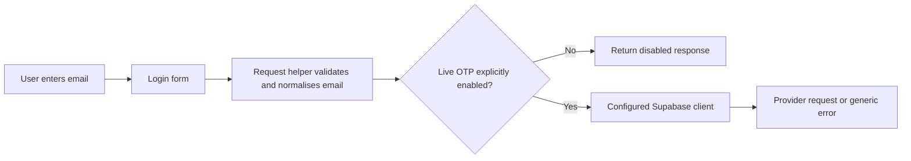
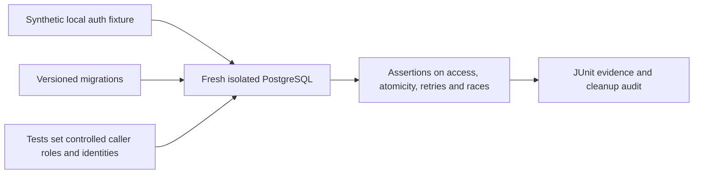

# ParentPlus — System Architecture

Status: current local foundation and intended boundaries, reconciled on 2026-11-03.
Deployment and complete user journeys are not established by this document.
[Build Progress](BUILD_PROGRESS.md) owns milestone status;
[Quality Evidence](QUALITY_EVIDENCE.md) owns verification provenance.

## Components and boundaries

| Component | Repository implementation | Boundary / limitation |
| --- | --- | --- |
| Web application | Next.js App Router, React and TypeScript; routes/components under apps/web/src | Coach screens include demonstration/placeholder behavior |
| Login UI | Email request form at /login | It is not a completed browser sign-in/session journey |
| Auth helpers | Request/verify email OTP helpers and Supabase client/config modules | Live calls require the explicit enable flag and configuration; recorded tests use mocks |
| Database foundation | PostgreSQL 17 SQL migrations under supabase/migrations | Schema/functions exist locally; no hosted deployment is attested |
| Database verification | Python unittest and standalone scenarios through existing Docker CI scripts | Synthetic auth fixture simulates identity; it is not real signed JWT validation |
| Quality system | Python gate, requirements/policy JSON and reusable GitHub workflows | Local result/receipt linkage is not production attestation or active branch protection |

Exact packages and scripts live in [the web manifest](../apps/web/package.json).
Exact SQL contracts live in [the migrations](../supabase/migrations/).
[Database Architecture](DATABASE_ARCHITECTURE.md) owns database design; do not
maintain a second schema in this file.

## Current auth and UI flow

The request helper prevents automatic signup and avoids exposing provider details.
A separate verification helper checks email/token format and requires a user and
session in a successful provider response. Its existence does not mean the login
page has a complete verification UI or that real provider/session behavior passed.
The coach dashboard uses local demonstration data; it is not evidence of an
integrated authorised-data journey.

## Database authorisation and test flow

Local functions cover workspace/profile foundations, child/guardianship creation,
guardian-initiated connection requests and controlled approval contracts. Initial
RLS and later privilege restrictions must be read from SQL; do not assume all
future table access is implemented. Ordinary application callers must not be
given the test database's privileged control role.

Connection approval, enrollment and sensitive learning-record access remain
separate boundaries. Email authentication or guardian self-declaration alone
must not grant unrestricted child-data access.

## Prepared quality and documentation flow

The gate collects actual test identities, validates their mappings, selects suites
from changes, and checks job outcomes plus source/report/run-bound receipts.
[The gate guide](INTELLIGENT_QUALITY_GATE.md) owns the detailed execution contract.
Workflows are committed locally but an actual hosted run is not attested here.

Documentation maintenance is performed by an invoked agent following
[the delivery workflow](FEATURE_DELIVERY_WORKFLOW.md). There is no automatic
cross-agent context-sync service or comprehensive documentation-freshness checker.
Those proposed checks require separate implementation approval.

## Intended future components

Classes/enrollment, attendance, private diary/media, historical records and full
account lifecycle behavior remain the responsibility of their future specs and
[roadmap](DEVELOPMENT_ROADMAP.md). Real auth, data access, consent and retention
integration must be designed and verified before the corresponding release.
No topology, hosting provider or live API endpoint is invented by this overview.

## Local first-use workspace boundary — 2026-11-09

The default-off `/coach-onboarding` view calls authenticated server actions in
`src/lib/workspace/first-use.ts`. Actions verify the current Auth user and expected
actor before using existing `create_workspace` or own, active-workspace RLS reads.
Minimal browser request markers and a Web Lock coordinate same-device retries;
empty reads stay unresolved. No service key or new database privilege is involved.
The local-only runner uses Mailpit and synthetic records against local Supabase;
this runtime boundary is separate from any hosted rollout.

## Local founder test boundary

`/founder` and the dummy-OTP server actions require development runtime, explicit
private/public founder flags and exact loopback Supabase endpoint. Dummy OTP is
exchanged server-side for an ordinary local user session; normal product actions
then use their existing identity/RPC/RLS checks. Only founder administrative actions
use the local service credential, which never enters public configuration or action
results. The launcher verifies Docker checkout ownership and restores feature
controls on normal shutdown. Production and hosted endpoints refuse this capability.

### Current founder testing deployment boundary — 2026-11-10

DEC-022 supersedes the earlier local-only founder restriction for this testing app.
Vercel testing defaults pin existing Supabase fmavpazczahxeusqbxuh. Dummy .test/123456
verification exchanges a server-generated hash for an ordinary user session; the
service credential stays on the server. Founder test controls intentionally allow
synthetic membership overrides without real identity verification. Anyone able to
reach this testing app can use those controls; this matches the requested testing
access and is not suitable for real family data or a launch claim. Normal persona
RPC/RLS policies remain. Existing rows were preserved through the014–049 upgrade.
The explicit launch-stage build stops forcing test defaults; a launch still needs
its own implementation and verification. Actual hosted app verification is pending.
