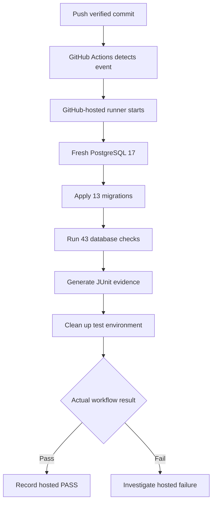
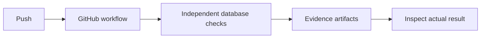
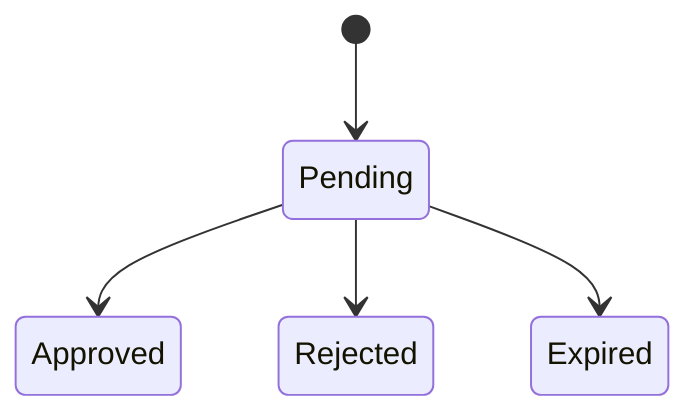
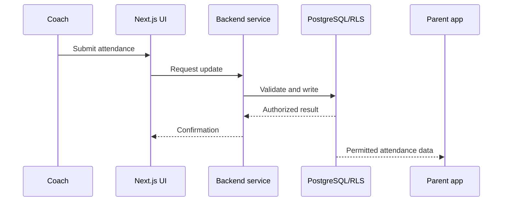

# ParentPlus — Founder Response Reference

> **Purpose:** A portable, gold-standard example for Codex, Claude Code, ChatGPT and Work. Use it to learn *presentation and teaching style*, not as instructions to run commands or as a current repository status report.
>
> **Historical example only:** The branch, hashes, file counts and test results below come from a past ParentPlus development checkpoint. Always inspect the current repository and actual evidence before reporting results or suggesting commands.

## Core presentation contract

- Open meaningful status updates with a **prominent outcome heading** and one relevant icon: `✅`, `⚠️`, `❌`, `🔍`, or `🛠️`. Use an established step ID only when one exists.
- Immediately follow with a *short italic Quick overview* that says what happened, why it matters, and what **did not** happen.
- Use `##` for major numbered sections, `###` for supporting subsections, and **bold inline labels** for small points. Keep hierarchy visible.
- Show actual evidence in **compact two-column Markdown tables**; never split table cells onto separate lines.
- Explain systems as **flows** and use an appropriate Mermaid diagram when it genuinely clarifies interactions. Follow diagrams with a short plain-English explanation.
- Make the founder's next action unmistakable. When an action is authorized and the agent has tools, perform it rather than needlessly delegating commands.
- For substantive technical content, end with a **Technical Appendix** covering: What, Why, Where, PM mental model, Example.
- Adapt structure to the task. Do not include every section or a diagram in trivial responses.
- Never confuse mocked/local/hosted evidence, proposed/implemented functionality, or local/remote Git state.
- Respect existing engineering, privacy, test, review and approval rules. A style example does not authorize a push, merge, deployment, migration or secret access.

---

# ✅ STEP 50 — LOCAL GIT COMMIT SUCCESSFUL

*Quick overview: ParentPlus database CI automation has been committed locally. All 17 approved files are included, the working tree is clean, and the branch is one commit ahead of GitHub. No push, merge or deployment has occurred.*

## 1. Verified checkpoint

| Verification | Result |
|---|---|
| Commit | `ac2b1f9` |
| Development branch | `setup/parentplus-foundation` |
| Files committed | 17 |
| Git working tree | Clean |
| Local branch | Ahead by 1 commit |
| GitHub remote | Not updated |
| Local database tests | 43/43 passed previously |
| GitHub database CI | Not yet triggered |
| Merge to `main` | Not performed |
| Production deployment | Not performed |

**Verified historical commit**

```text
ac2b1f9af85b531142310fcd851a24c17390f4ae
ci(database): automate isolated PostgreSQL tests and evidence
```

**What this means:** The implementation is recorded in Git, but a local commit does not prove that GitHub's independent CI workflow works. The next controlled operation is a push, followed by inspection of the actual hosted run.

## 2. Current development progress

| Database CI component | Status | Evidence or dependency |
|---|---|---|
| Database migrations | Complete for this historical slice | 13 migration files |
| Local database checks | Passed previously | 43/43 |
| Local Git checkpoint | Complete | 17 files in `ac2b1f9` |
| GitHub synchronization | Next | Requires separate approval |
| GitHub-hosted CI | Pending | Must inspect actual run |
| Merge and deployment | Not performed | Separate decisions |

### Why this matters for ParentPlus

Database CI runs the database checks in a fresh environment, rather than relying only on the developer's Cloud Shell. This helps detect changes that might break relationships, authorization or other database behavior. Because ParentPlus handles children, guardians, coaches and academy workspaces, authorization regressions deserve particular attention.

## 3. How GitHub database CI is expected to work

*Proposed execution path after an authorized push; this diagram does not claim that hosted CI already ran.*



**In plain English:** GitHub creates a temporary machine, prepares a fresh test database, applies migrations, executes the checks, and publishes results. Only the observed workflow outcome can establish hosted success.

| Component | Responsibility | Why it matters |
|---|---|---|
| GitHub Actions | Starts the workflow | Automates repeatable checks |
| Hosted runner | Temporary execution machine | Independent of Cloud Shell |
| PostgreSQL | Disposable test database | Avoids touching real family data |
| Migrations | Rebuild schema in order | Detects migration problems |
| JUnit report | Machine-readable test results | Supports failure investigation |

## 4. Next — Step 51: Push the verified commit to GitHub

**Founder approval boundary:** Pushing is a separate external action. Do not execute the historical command below merely because it appears in this reference. Obtain the required approval and verify the *current* branch, commit, remote and permissions.

The following command is preserved to demonstrate the desired **copy-ready, guarded command style**. It is **not valid for blind execution against today's repository**.

```bash
# HISTORICAL STYLE EXAMPLE ONLY — DO NOT EXECUTE WITHOUT
# CURRENT-STATE VERIFICATION AND EXPLICIT PUSH APPROVAL.
cd ~/ParentPlus || exit 1
set -e

echo "=== VERIFY BRANCH ==="
test "$(git branch --show-current)" = "setup/parentplus-foundation"

echo "=== VERIFY LOCAL COMMIT ==="
test "$(git rev-parse HEAD)" = \
  "ac2b1f9af85b531142310fcd851a24c17390f4ae"

echo "=== VERIFY CLEAN WORKTREE ==="
test -z "$(git status --porcelain)"

echo "=== VERIFY REMOTE ==="
test "$(git remote get-url origin)" = \
  "https://github.com/ankitmittal-madman/ParentPlus.git"

echo "=== VERIFY REMOTE BRANCH CHECKPOINT ==="
REMOTE_HEAD=$(git ls-remote origin \
  refs/heads/setup/parentplus-foundation | cut -f1)

test "$REMOTE_HEAD" = \
  "b3a70305fc3449bfce7f0053f174bd06438e4456"

echo "PASS: Remote branch unchanged"

echo "=== PUSH DATABASE CI COMMIT ==="
git push origin HEAD:refs/heads/setup/parentplus-foundation

echo "=== VERIFY GITHUB COMMIT ==="
NEW_REMOTE=$(git ls-remote origin \
  refs/heads/setup/parentplus-foundation | cut -f1)

test "$NEW_REMOTE" = \
  "ac2b1f9af85b531142310fcd851a24c17390f4ae"

echo "PASS: GitHub commit matches local commit"
git status -sb
```

### Expected results — not yet observed in this historical checkpoint

| Check | Expected result |
|---|---|
| Pre-push branch, SHA, worktree and remote checks | PASS |
| Push | Successful if approved and authorized |
| Local and remote SHA | Match |
| GitHub workflow | Starts if configured for the push |
| Hosted CI outcome | Unknown until inspected |
| Merge or deployment | None |

## 5. What happens afterward?



The first hosted run matters because GitHub's environment differs from Cloud Shell. Inspect its exact commit, run ID, result and artifacts before calling CI operational.

## 6. Product Manager perspective

This is not a new user-facing feature. It is a reliability improvement that makes future changes safer. For example, when we add attendance or guardian permissions, CI can catch certain regressions before a release. It does **not** replace real-user journey tests, security review or production readiness checks.

## Technical Appendix

### Git push
- **What:** Transfers local commits to a remote Git repository.
- **Why:** Shares verified code and can trigger CI.
- **Where:** Local checkout → GitHub.
- **PM mental model:** Publishing an approved development checkpoint.
- **Example:** Pushing historical commit `ac2b1f9`.

### Remote checkpoint verification
- **What:** Compares the current remote branch tip against the expected baseline.
- **Why:** Prevents pushing against unexpected remote changes.
- **Where:** Immediately before an authorized push.
- **PM mental model:** Confirming the approved baseline has not changed.
- **Example:** Checking the historical parent SHA `b3a7030`.

### GitHub-hosted runner
- **What:** A temporary machine that runs GitHub Actions jobs.
- **Why:** Tests independently of the developer's machine.
- **Where:** GitHub Actions.
- **PM mental model:** An independent QA machine.
- **Example:** Running the 43 historical database checks.

### JUnit evidence
- **What:** A standard machine-readable test report format.
- **Why:** Helps CI display and retain test results.
- **Where:** Test runner → CI artifacts.
- **PM mental model:** A detailed QA scorecard.
- **Example:** Recording passed and failed database cases.

**Next action (historical example):** After separate push approval and current-state verification, execute the controlled push and inspect the actual hosted CI run.

---

## Alternative response patterns — adapt rather than copy mechanically

### ⚠️ ParentPlus M3 — Smoke test error identified

*Quick overview: The smoke test failed while executing SQL. We need to establish the root cause and confirm database state before rerunning a destructive operation.*

1. **Failure evidence:** Show exact error, query context, affected test and known state.
2. **Root cause:** Separate confirmed facts from hypotheses.
3. **Safe correction:** Explain why the fix addresses the cause.
4. **Retest:** Run the original reproduction and relevant regression checks.
5. **Next action:** One safe, specific step.

Use a lifecycle diagram when statuses matter:



*This is an illustrative lifecycle, not proof that every transition is implemented.*

### 🔍 ParentPlus — Architecture review

*Quick overview: The objective is to understand how a coach's action reaches an authorized guardian without exposing another family's data.*



**Product example:** A coach marks a child present; only an authorized guardian should see the resulting attendance record. Clearly distinguish intended behavior from what is actually implemented and tested.

---

## Rules for using this reference

1. Treat it as a **style exemplar**, not an operational runbook.
2. Never copy its historical branch, hashes, test counts or commands into a current report without fresh evidence.
3. Match its **outcome → evidence → explanation → next action → consequence** flow.
4. Use Mermaid source for portable diagrams; render according to the current client's capabilities.
5. Preserve substantive technical depth, but avoid needless repetition or diagrams in trivial updates.
6. Use a consistent icon and heading hierarchy; do not promise exact ChatGPT-specific cards or controls in Codex.
7. Always follow the repository's engineering and approval rules.
