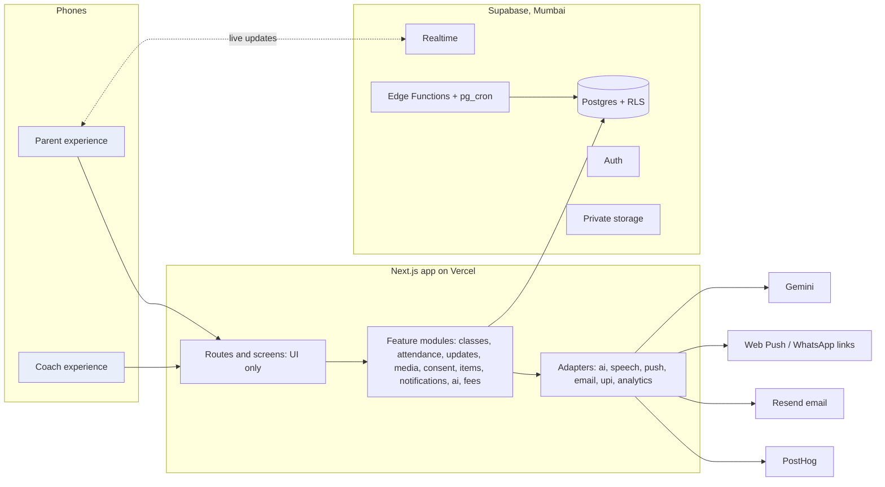

# 03. Architecture

**In short:** one installable web app (two experiences: coach and parent) on Next.js; all data, sign-in, files and timed jobs on Supabase, protected by rules inside the database; outside helpers (AI, notifications, email, UPI, analytics) each behind a swappable adapter. Everything runs on free tiers during the build.

## 1. System at a glance

## 2. Layers and the rule for each

| Layer | Holds | Rule |
|---|---|---|
| Interfaces | Coach and parent screens (PWA). A native app or WhatsApp later | Show data and call modules. No business rules. Render parent items by type, with a fallback |
| Feature modules | Business rules, validation (zod), queries | No UI imports. Each module has its own tests |
| Database | Tables, RLS, triggers, actions (RPC) | Security lives here. Every table has RLS and SQL tests |
| Jobs | Session generation, reminders, outbox sender, AI drafts, backups | Idempotent: safe to run twice |
| Adapters | One file per outside service | The only place vendor code lives. Swappable within a day |

## 3. Key flows

### Coach publishes an update
1. The coach approves a draft in the app.
2. A server action calls `publish_post(post_id)`.
3. The database checks `can_manage_class`, then creates one `parent_items` row per child in the audience.
4. The session is marked `posted`; a `post_published` event is logged.
5. The outbox (Stage 6) sends push notifications, or prepares WhatsApp links.
6. The parent app reads its `parent_items` and fetches photos through signed URLs, after `can_see_media` passes.

### Attendance
The coach saves attendance. A trigger fills in the class and the India-time date, rejects children who aren't enrolled, and creates an `attendance_record` item and an `attendance_marked` event. Parents see it live through Realtime.

## 4. Environments

| Environment | Code | Database | Who uses it |
|---|---|---|---|
| Preview | Every pull request | Supabase `parentplus-staging` | Founder trying changes |
| Staging | `main` branch | `parentplus-staging` | Rehearsals, demo data |
| Production | Release tags after a gate | `parentplus-prod` | Real families (from Stage 7) |

The free tier allows 2 active Supabase projects, which is exactly staging and production.

## 5. Security model

Sign-in with Supabase Auth. Permissions come from relationships: a guardian of which child, a coach of which class. They never come from a role flag. RLS protects every table, proven by the tests in `supabase/tests`. The service-role key is used only in server code and jobs. Photos and clips sit in a private bucket; parents get links that expire in 1 hour or less. See `docs/08`.

## 6. Scaling path (when, not now)

| Trigger | Move |
|---|---|
| Data over about 400 MB, or a need for automatic backups and no pausing | Supabase Pro |
| Media over about 800 MB | Move media to Cloudflare R2 (adapter change only) |
| More than 100 sign-in emails a day | Resend Pro, or nudge users to Google sign-in |
| Commercial launch on Vercel | Vercel Pro, or move to Cloudflare (ADR-007) |
| Automatic WhatsApp needed | WhatsApp Business API through the push adapter |

## 7. Free-tier facts we rely on (checked 27 Oct 2026)

Supabase Free: 500 MB database, 1 GB files, 5 GB egress, 50,000 monthly active users, pauses after 1 week of inactivity, no automatic backups, and built-in email only to team addresses. Vercel Hobby: non-commercial use only. GitHub Free: 2,000 Actions minutes a month and 500 MB artifact storage. Codespaces: 120 core-hours a month. Resend Free: 3,000 emails a month, 100 a day. PostHog Free: 1M events and 100K exceptions a month. Cloudflare R2: 10 GB-month free, no egress fees.
