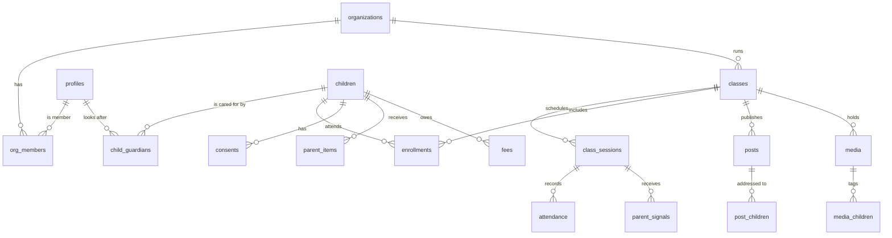

# 04. Data model

**In short:** 19 tables for Pilot v1, in `supabase/migrations/0001_core_schema.sql`. They keep the MVP's 7 table names and add what Module 2 needs. Who can see what is decided by rules inside the database, and 55 automated tests prove those rules.

## Tables

| Table | Holds | MVP name kept? | Stage |
|---|---|---|---|
| organizations | Academies (a solo tutor is an academy of one) | New | 1 |
| profiles | Every coach and parent; created automatically at sign-up | Yes | 1 |
| org_members | Who belongs to which academy, and as what (owner, coach, assistant) | New | 1 |
| children | Each child | Yes | 2 |
| child_guardians | Which adults look after which child; who gets updates, pays fees, may pick up | New | 2 |
| classes | Batches, with their repeating schedule, venue, room and fee | Yes | 2 |
| class_sessions | One class on one date: the anchor for everything | New | 2 |
| enrollments | Which child is in which batch (trial, active, paused, left) | Yes | 2 |
| invites | Single-use family invite links (14-day expiry) | New | 2 |
| attendance | Present, absent, late, excused or make-up, per child per session | Yes | 3 |
| parent_signals | Running late, missing, dropped off, picked up | New | 3 |
| consents | Append-only consent history per child and scope | New | 4 |
| posts | Coach's updates, notes, announcements, moments (drafts and sent) | Yes | 4 |
| post_children | Who a personal post is for | New | 4 |
| media | Photos, clips and audio (private storage paths) | New | 4 |
| media_children | Who is tagged in each media item | New | 4 |
| parent_items | Typed items parents receive (the UI-agnostic contract) | New | 1 |
| fees | Dues (manual for now; plans and payments arrive in Stage 9) | Yes | 9 |
| events | Log of important actions; backend only | New | 1 |

Later migrations add: `ai_drafts`, `observations` (Stage 5), `outbox`, `push_subscriptions`, `message_templates`, `session_rsvps`, `calendar_events` (Stage 6), and `fee_plans`, `payments` (Stage 9).

## Relationships

## Access rules in plain words

| Who | Can see | Can change |
|---|---|---|
| A parent or guardian | Their own children, their classes and schedules, their typed items, their child's attendance; photos only when consent rules pass; fees only if they are the paying guardian | Their own profile and consents; signals for their own child |
| A coach | Their batches, the children enrolled in them, those children's guardians, signals and consents | Batches, sessions, enrolments, attendance, posts and media for their own batches |
| An academy owner | Everything in their academy | Everything in their academy, including the team |
| A stranger or a signed-out visitor | Nothing (only their own profile, once signed in) | Nothing |

Photos: a guardian sees a photo only if their child is tagged, they consented to that media type, **and** every other tagged child's family allowed group photos. Withdrawing consent hides photos immediately (tests T46 to T51).

## Actions the apps call

| Action | Does |
|---|---|
| `generate_sessions(class, from, to)` | Creates sessions from the schedule rule; safe to re-run; India time |
| `accept_invite(token)` | Adds the signed-in person as a guardian; single-use; expires |
| `publish_post(post)` | Fans a post out as one typed item per child; never sends twice |

## Conventions

snake_case names, uuid keys, `timestamptz` times, money in paise, allowed values as check constraints (easier to extend than Postgres enums), indexes on every column used by a rule. Never edit an applied migration.
